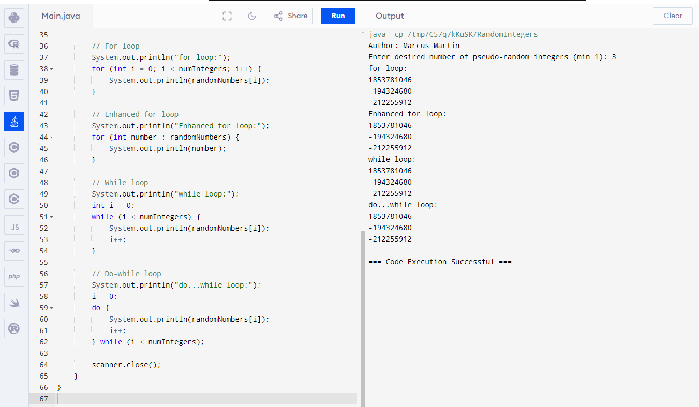

> **NOTE:** This README.md file should be placed at the **root of each of your main directory.**

# Mobile Web App development

## Marcus Martin

### Class Number: LIS4381

1. [p1 README.md](a1/p1_README.md "My p1 README.md file")
    - Make Launcher Icon
    - Add Borders to Image and Button
    - Add background color  

##### Assignment Screenshots

 

*Screenshots of Problem sets*

 *Largest Array*
  
 *Largest three Numbers*
 
 *Random number Generator*
   