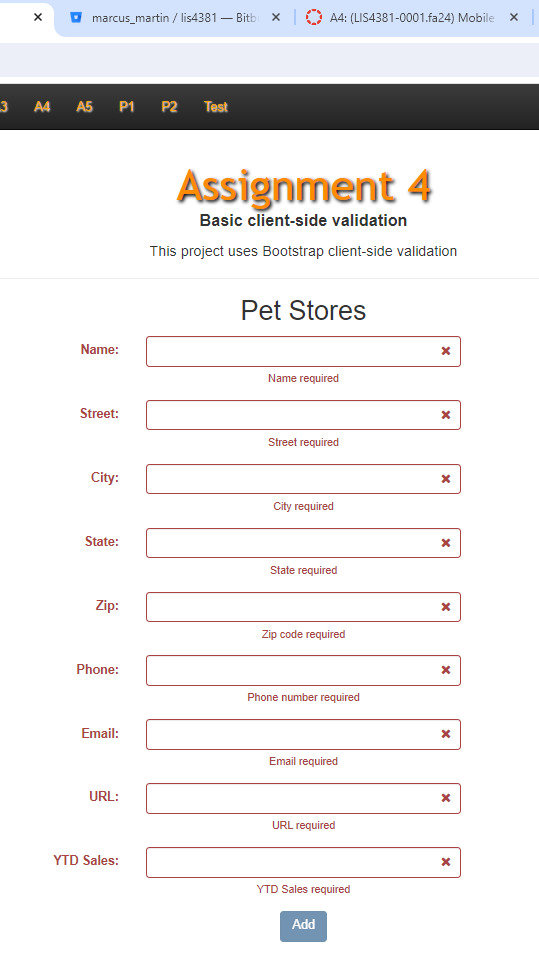
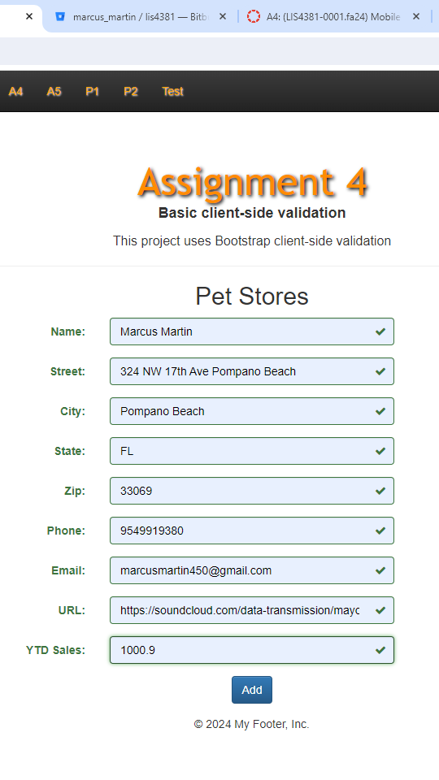
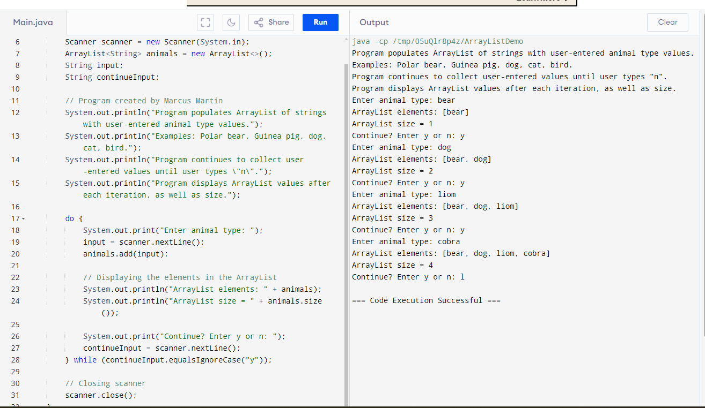
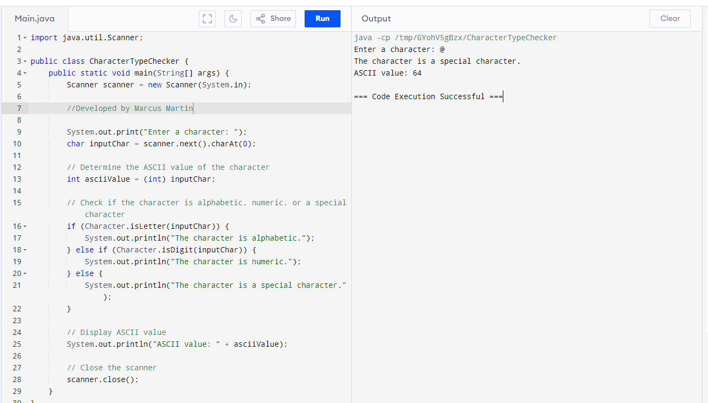
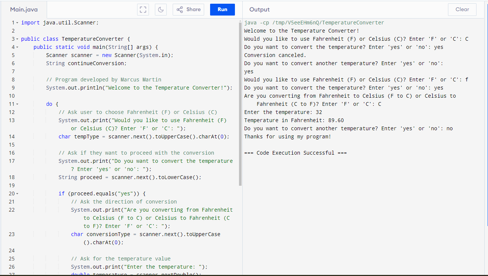

> **NOTE:** This README.md file should be placed at the **root of each of your main directory.**

# Mobile Web App development

## Marcus Martin

### Class Number: LIS4381

1. [A4 README.md](lis4381/A4_README.md "My A4 README.md file")
    - Clone a repository
    - Add Jquery Validation
    - Create a favicon

    ##### Assignment Screenshots
 
 

*Screenshots of Problem sets*

 *Array List*
  
 *Alpha Numeric*
 
 *Temperature Conversion*
   