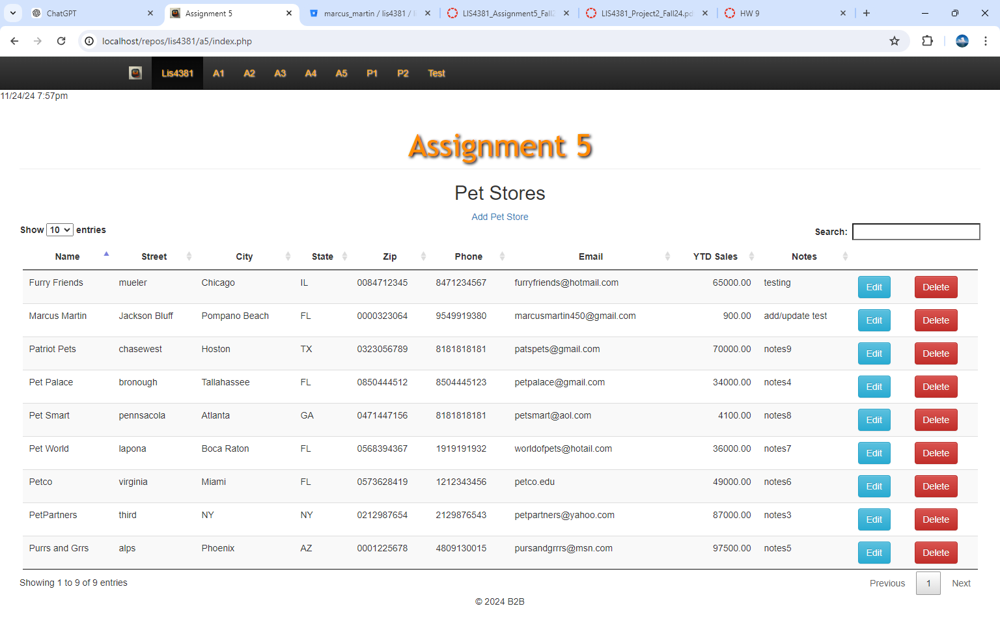
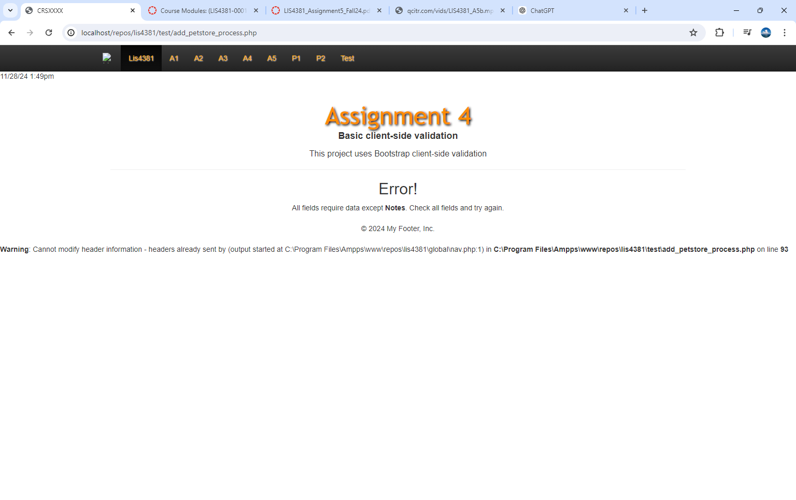
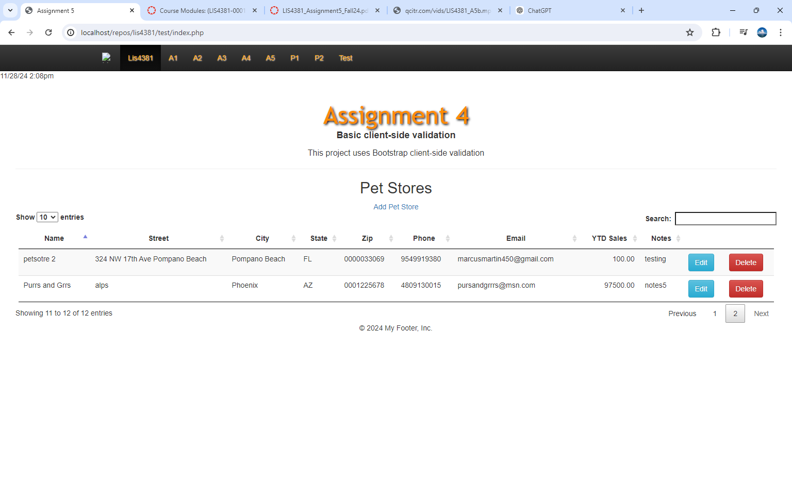
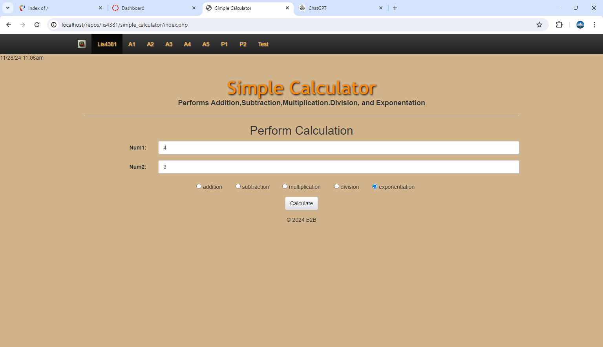
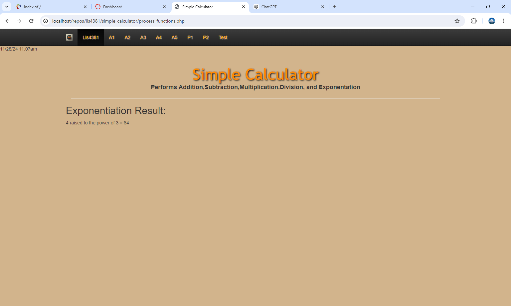
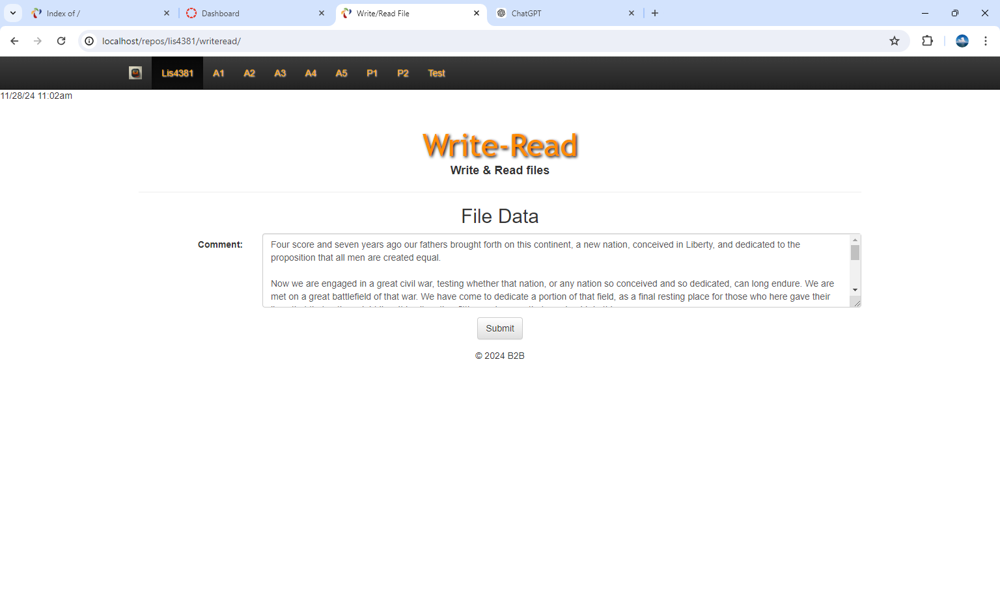
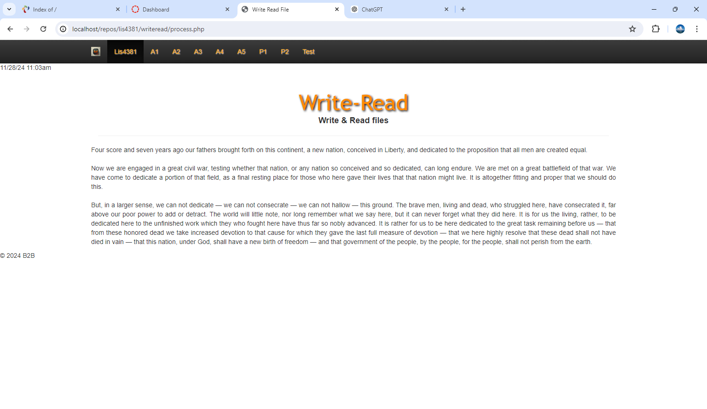
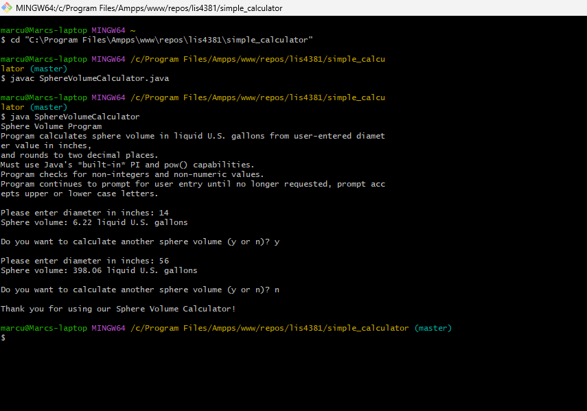
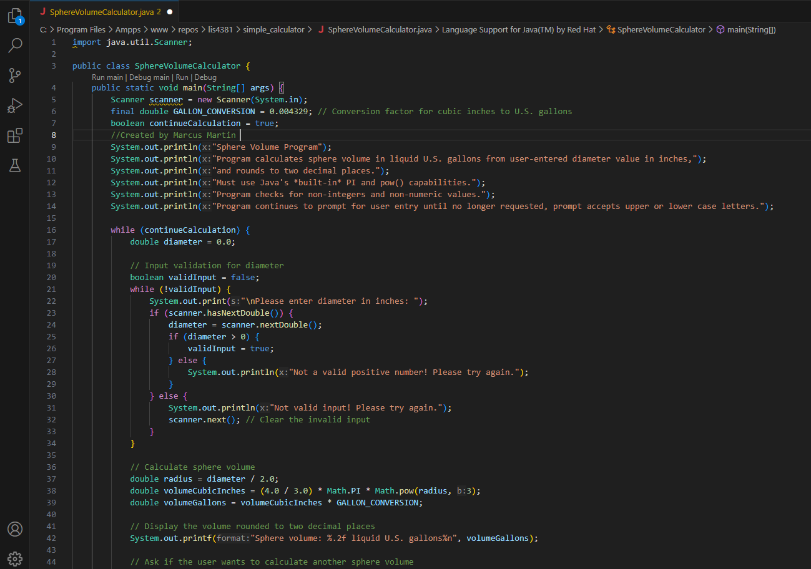

 **NOTE:** This README.md file should be placed at the **root of each of your main directory.**

# Mobile Web App development

## Marcus Martin

### Class Number: LIS4381

1. [A5 README.md](lis4381/A5_README.md "My A5 README.md file")
    - Turn off server side validation
    - Establish Database Connection
    - add placeholders into fields
    - Implement add functionality into database 

##### Index
 
##### Invalid
 
##### Passed Validation

##### Simple Calculator

##### Write-Read

##### Skillset 13 code

#####  Skillsetcode 13 Running
