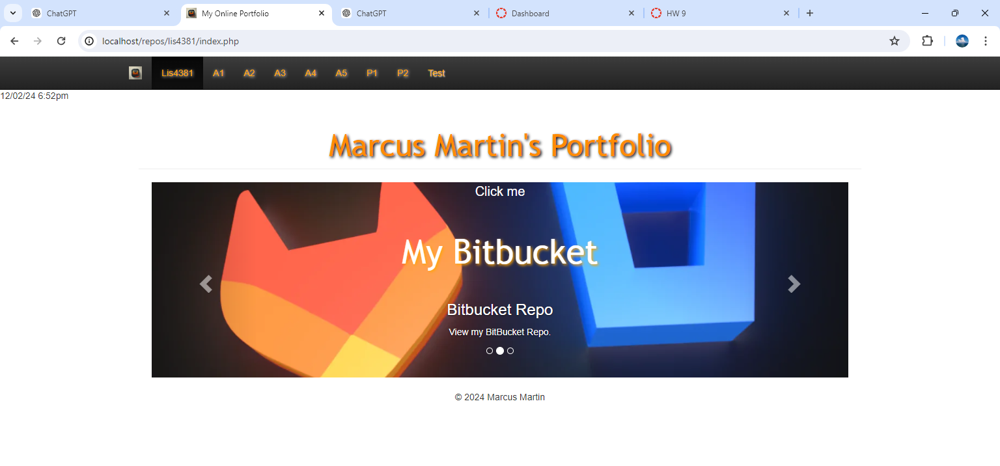
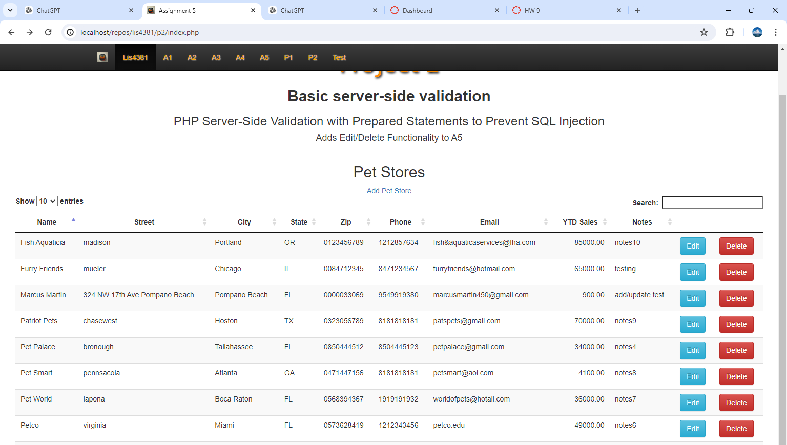
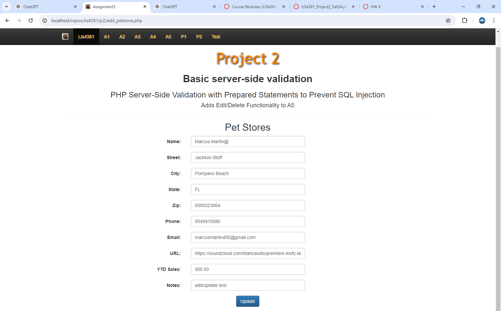
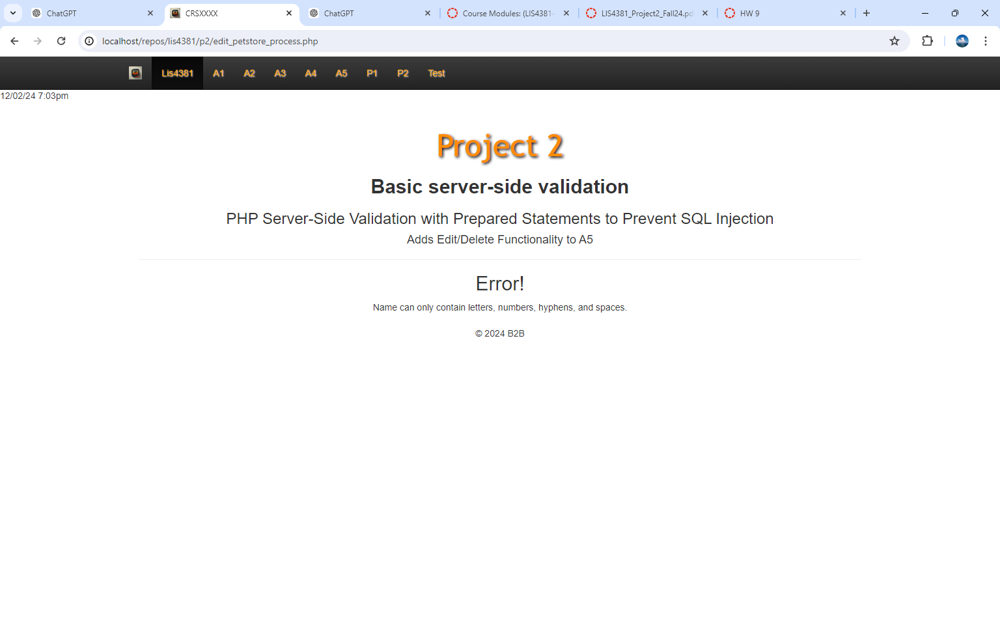
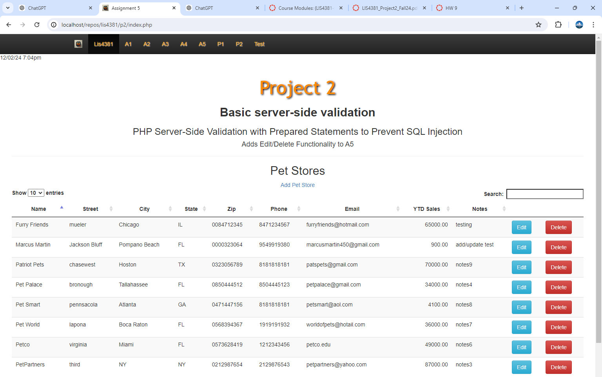
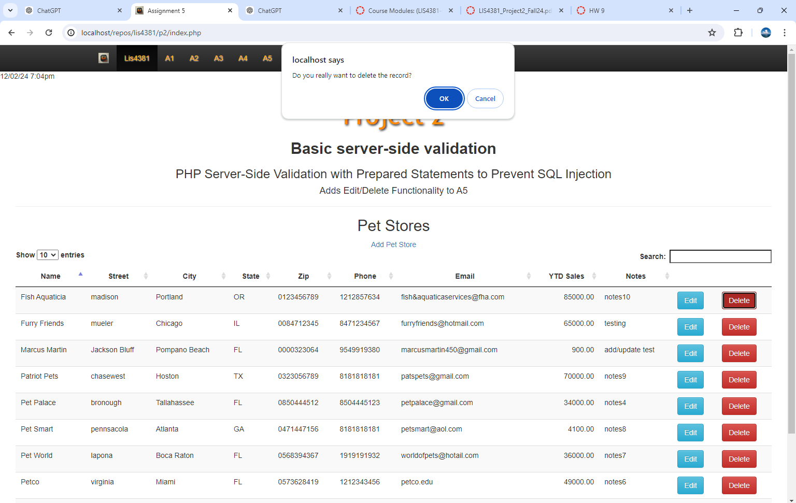
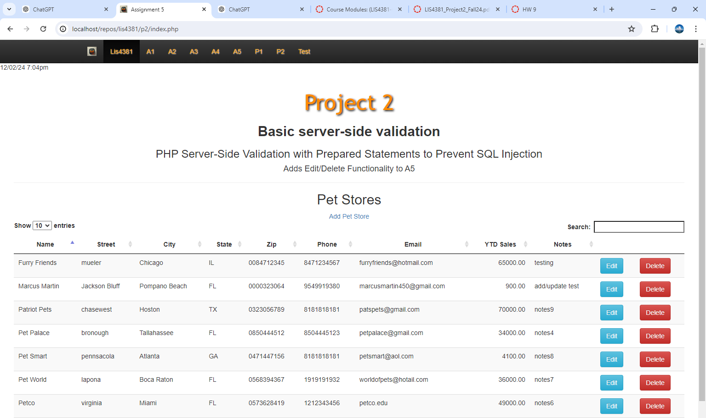
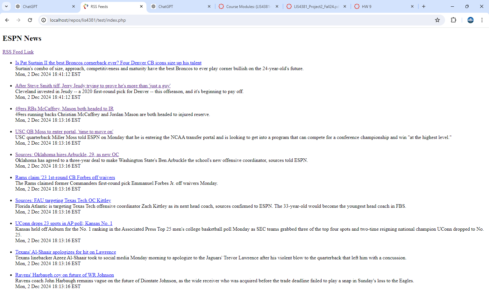

**NOTE:** This README.md file should be placed at the **root of each of your main directory.**

# Mobile Web App development

## Marcus Martin

### Class Number: LIS4381

http://localhost/repos/lis4381/index.php

1. [p2 README.md](lis4381/p2_README.md "My p2 README.md file")
    - Add edit/delete functionality a5
    - Update data in database
    - Create Rss page
    - update metatags

    ##### Assignment Screenshots
 
 

  